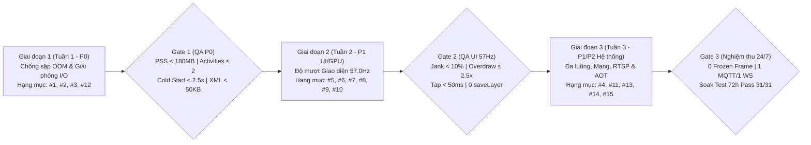

# KẾ HOẠCH TRIỂN KHAI CHI TIẾT & ĐÁNH GIÁ CHẤT LƯỢNG (QA/DoD) TỪNG THÀNH PHẦN — `com.lumi.wallpad` (SM10P)

- **Dự án:** Tối ưu hóa Hiệu năng & Độ bền Vận hành 24/7 cho `com.lumi.wallpad` (từ nền tảng `v1.0.12`)
- **Thiết bị chuẩn nghiệm thu:** `SM10P` (`ADPCP524080961` — SoC 4× Cortex-A55 @ 1.42GHz, GPU Mali-G52, RAM 2GB, Màn hình `1920×1200 @ 57.0Hz` / `17.54ms` VSync)
- **Phạm vi:** **15 Thành phần Kỹ thuật** chia làm **3 Giai đoạn (Sprints)**, giải quyết dứt điểm **24 tiêu chí FAIL** và **2 tiêu chí WARN**.

---

## 1. TỔNG QUAN LỘ TRÌNH 3 GIAI ĐOẠN (ROADMAP & GATES)



| Giai đoạn | Mục tiêu Trọng tâm | Các Thành phần Thực hiện | Thời lượng Dự kiến | Cổng Nghiệm thu (Quality Gate) |
| :--- | :--- | :--- | :---: | :--- |
| **Giai đoạn 1 (P0)** | **Chống tràn RAM (OOM) 24/7 & Xóa nghẽn I/O Luồng chính** | **#1** (Backstack Activity), **#2** (Native Heap & `onTrimMemory`), **#3** (Tách `wallpad_prefs.xml` 1.99MB sang `Room SQLite`), **#12** (Bỏ IPC `ScreenSaverService` khi chạm) | **5 – 7 ngày** | • Activities sống `≤ 2` (từ `30`)<br>• Total PSS `< 180 MB` (từ `503.4 MB`)<br>• Cold Start `< 2.5s` (từ `10.67s`)<br>• Input Latency P90 `< 2.0ms` (từ `11.07ms`) |
| **Giai đoạn 2 (P1 - UI/GPU)** | **Tối ưu Toàn diện Độ mượt Giao diện chuẩn 57.0Hz (`17.54ms`)** | **#5** (Cây View `≤ 10 cấp` & `ViewPager2`), **#6** (Hạ `Overdraw ≤ 2.5x` & xóa `378 saveLayer`), **#7** (`RecyclerView DiffUtil`, Vector/Palette cache), **#8** (`Hardware Bitmap`), **#9** (Gom nhịp `VSync`), **#10** (`ViewOutlineProvider`) | **6 – 8 ngày** | • Jank Rate toàn phiên `< 10%` (từ `74.57%`)<br>• Overdraw `≤ 2.5x` (từ `14.8x`)<br>• Bấm nút/tab SmartHome `< 50ms` (từ `109–567ms`)<br>• `Slow Bitmap Uploads = 0%`, `saveLayer = 0` |
| **Giai đoạn 3 (P1/P2 - Hệ thống)** | **Ổn định Đa luồng, Kết nối Mạng, Video RTSP & Biên dịch AOT** | **#13** (Singleton `MQTT/WS` & ThreadPool), **#14** (Khử khóa `synchronized` trên UI), **#15** (Tối ưu Camera RTSP & `HWC Overlay`), **#11** (`Baseline Profiles`), **#4** (`WorkManager` WAL) | **4 – 5 ngày** | • `0 Frozen Frames` (> 700ms), `0 UI Lock Wait`<br>• Duy nhất `1 MQTT + 1 WebSocket`, `< 50 Threads`<br>• CPU khi ẩn Camera `< 15%`, `0 JIT` khi cuộn<br>• Vượt qua bài đo Stress/Soak 24h liên tục |

---

## 2. KẾ HOẠCH TRIỂN KHAI & TIÊU CHUẨN ĐÁNH GIÁ CHẤT LƯỢNG CHI TIẾT CHO TỪNG THÀNH PHẦN (15 HẠNG MỤC)

---

### NHÓM A: QUẢN LÝ VÒNG ĐỜI MÀN HÌNH (ACTIVITY LIFECYCLE) & BỘ NHỚ RAM

---

#### Thành phần #1 [P0]: Điều hướng & Quản lý Backstack các Activity (`MainActivity`, `SmartHome`, `Camera`, `Intercom`, `Music`, `Settings`)
- **Mã tiêu chí liên quan:** `3.2`, `4.5 (B5)`, `1.4`
- **Hiện trạng lỗi:** Chuyển qua lại giữa các màn hình tạo mới `Activity` liên tục mà không đóng instance cũ → Tồn đọng **30 Activities**, **29 `ViewRootImpl`**, **11,970 Views**, rò rỉ **+49.4 MB PSS/vòng**, gây tràn RAM (OOM) sau 15–25 vòng.

##### 1. Kế hoạch triển khai kỹ thuật (Implementation Steps)
1. **Cấu hình `AndroidManifest.xml`:**
   - Đặt `android:launchMode="singleTask"` cho `MainActivity` (màn hình gốc Dashboard).
   - Đặt `android:launchMode="singleTop"` cho các Activity chức năng (`SmartHomeActivity`, `CameraActivity`, `IntercomActivity`, `MusicActivity`, `SettingsActivity`).
2. **Chuẩn hóa Router / Điều hướng (`Navigator`):**
   - Khi mở từ `MainActivity` sang màn hình con: sử dụng `Intent.FLAG_ACTIVITY_CLEAR_TOP | Intent.FLAG_ACTIVITY_SINGLE_TOP`.
   - Khi từ màn hình con bấm nút Home hoặc chuyển sang màn hình con khác: bắt buộc gọi `finish()` trên Activity hiện tại.
   - Ghi đè `onNewIntent(intent)` tại các Activity để cập nhật dữ liệu mới thay vì khởi tạo lại Activity.
3. **Dọn dẹp tham chiếu trong `onDestroy()`:**
   - Gỡ đăng ký toàn bộ `EventBus.getDefault().unregister(this)`, `BroadcastReceiver`, `ContentObserver`, `Handler.removeCallbacksAndMessages(null)` và hủy `CoroutineScope` gắn với vòng đời màn hình (`lifecycleScope`).

##### 2. Đánh giá chất lượng & Tiêu chuẩn nghiệm thu (QA & DoD)
| Chỉ số Đánh giá | Trước tối ưu (Baseline) | Ngưỡng Nghiệm thu (DoD) | Công cụ / Lệnh Kiểm tra trên SM10P |
| :--- | :---: | :---: | :--- |
| **Số `Activities` tồn tại trong tiến trình** | `30` | **`1 – 2`** | `adb shell dumpsys meminfo com.lumi.wallpad \| grep -E "Activities\|ViewRootImpl"` |
| **Số `ViewRootImpl` đang hoạt động** | `29` | **`1 – 2`** | `adb shell dumpsys meminfo com.lumi.wallpad \| grep "ViewRootImpl"` |
| **Tổng số `Views` toàn tiến trình** | `11,970` | **`< 1,500`** | `adb shell dumpsys meminfo com.lumi.wallpad \| grep "Views:"` |
| **Tốc độ rò rỉ RAM sau mỗi vòng điều hướng** | `+49.4 MB/vòng` | **`≤ 0.5 MB/vòng`** (Hội tụ sau GC) | Chạy script lặp 20 vòng qua 6 màn hình → Gọi `cmd activity send-trim-memory` → Đo độ lệch PSS |
| **Kiểm soát hồi quy (Regression Check)** | — | **Pass 100%** | Kiểm tra nút Back vật lý/trên màn hình, nhận cuộc gọi Intercom đè lên khi đang ở màn hình SmartHome/Music không làm mất trạng thái. |

---

#### Thành phần #2 [P0]: Bộ nhớ Native Heap & Cơ chế Giải phóng Cache (`onTrimMemory`)
- **Mã tiêu chí liên quan:** `3.2`
- **Hiện trạng lỗi:** `Native Heap` phình tới **297.7 MB PSS**, đẩy **344.3 MB** xuống `ZRAM Swap`; khi hệ điều hành gửi tín hiệu `TRIM_MEMORY_RUNNING_CRITICAL`, ứng dụng không giải phóng bộ nhớ mà PSS còn tăng từ `478.3 MB → 491.6 MB`.

##### 1. Kế hoạch triển khai kỹ thuật (Implementation Steps)
1. **Triển khai `ComponentCallbacks2` trong lớp `WallpadApplication` và `BaseActivity`:**
   - Trong `onTrimMemory(level: Int)`:
     - Khi `level >= TRIM_MEMORY_RUNNING_LOW` hoặc `level == TRIM_MEMORY_UI_HIDDEN`: gọi `Glide.get(this).trimMemory(level)`, xóa bộ đệm icon/ảnh tạm thời (`LruCache.evictAll()`).
     - Khi `level >= TRIM_MEMORY_RUNNING_CRITICAL`: gọi `Glide.get(this).clearMemory()`.
2. **Cấu hình giới hạn bộ nhớ `AppGlideModule` cho thiết bị RAM 2GB:**
   - Giới hạn `MemoryCache` tối đa **15 MB** và `BitmapPool` tối đa **15 MB** (`setMemoryCache(LruResourceCache(15 * 1024 * 1024))`).
   - Đặt định dạng giải mã mặc định là `DecodeFormat.PREFER_RGB_565` (giảm 50% RAM mỗi ảnh so với `ARGB_8888`) cho toàn bộ ảnh nền phòng/cảnh không cần độ trong suốt.
   - Bắt buộc truyền `.override(targetWidth, targetHeight)` khi nạp ảnh thay vì nạp ảnh gốc độ phân giải cao.

##### 2. Đánh giá chất lượng & Tiêu chuẩn nghiệm thu (QA & DoD)
| Chỉ số Đánh giá | Trước tối ưu (Baseline) | Ngưỡng Nghiệm thu (DoD) | Công cụ / Lệnh Kiểm tra trên SM10P |
| :--- | :---: | :---: | :--- |
| **Tổng bộ nhớ chiếm dụng (`Total PSS`)** | `503.4 MB` | **`< 180.0 MB`** | `adb shell dumpsys meminfo com.lumi.wallpad \| grep "TOTAL PSS"` |
| **Bộ nhớ `Native Heap PSS`** | `297.7 MB` | **`< 90.0 MB`** | `adb shell dumpsys meminfo com.lumi.wallpad \| grep "Native Heap"` |
| **Mức giảm PSS khi gọi `send-trim-memory`** | Tăng `+13.3 MB` | **Giảm `≥ 15% – 20%`** | `adb shell cmd activity send-trim-memory com.lumi.wallpad RUNNING_CRITICAL` |
| **Kiểm soát hồi quy (Regression Check)** | — | **Pass 100%** | Kiểm tra chất lượng hiển thị ảnh nền phòng và icon thiết bị trên màn hình `1920×1200` không bị vỡ hạt hoặc mất kênh trong suốt của icon PNG/Vector. |

---

### NHÓM B: LƯU TRỮ DỮ LIỆU, ĐỌC/GHI FLASH eMMC & THU GOM RÁC BỘ NHỚ (GC)

---

#### Thành phần #3 [P0]: Tách file cấu hình `wallpad_prefs.xml` (`1.99 MB`) sang `Room SQLite Database`
- **Mã tiêu chí liên quan:** `4.3 (B3)`, `2.4`, `2.5`, `2.7a (A4)`, `3.3`, `3.7`
- **Hiện trạng lỗi:** Lưu toàn bộ danh sách thiết bị, phòng, kịch bản dạng chuỗi JSON lớn vào `shared_prefs/wallpad_prefs.xml` (**1.99 MB**). Mỗi lần khởi động hoặc đổi trạng thái 1 thiết bị phải đọc/parse/serialize lại cả file 1.99 MB → Làm **Cold Start mất 10.67s**, gây **89 lần I/O wait** trên UI Thread (max `62.08ms`), kích hoạt **50 đợt GC/4 phút** (`WaitForGc = 511.5ms`) và ghi Flash tới **~610.8 MB/ngày**.

##### 1. Kế hoạch triển khai kỹ thuật (Implementation Steps)
1. **Thiết kế `Room SQLite Database` (`WallpadDatabase`):**
   - Tạo các bảng thực thể độc lập: `DeviceEntity`, `RoomEntity`, `SceneEntity`, `FloorEntity` có đánh chỉ mục (`@Index(value = ["roomId", "deviceId"])`).
   - Bật chế độ `JournalMode.WRITE_AHEAD_LOGGING` (WAL) cho Room để đọc và ghi không khóa nhau.
2. **Viết `Migration` chuyển đổi dữ liệu tự động từ `wallpad_prefs.xml`:**
   - Khi nâng cấp ứng dụng lần đầu, chạy tác vụ nền trên `Dispatchers.IO`: đọc các khóa JSON lớn trong `wallpad_prefs.xml`, lưu vào bảng `Room`, sau đó gọi `editor.remove(largeJsonKey).apply()` để thu gọn file `wallpad_prefs.xml` xuống **< 50 KB** (chỉ giữ Token, IP HC, cài đặt âm lượng/độ sáng).
3. **Cập nhật theo dòng (`Row-level Update`) thay vì ghi đè toàn bộ:**
   - Khi 1 công tắc/thiết bị đổi trạng thái: chỉ gọi `@Query("UPDATE devices SET state = :newState WHERE id = :id")` trên `Dispatchers.IO` (tốn `< 500 bytes` ghi đĩa thay vì ghi đè `1.99 MB`).
4. **Cấm tuyệt đối đọc DB / Parse JSON trên Main Thread:**
   - Bật `StrictMode.ThreadPolicy.Builder().detectDiskReads().detectDiskWrites()` trong bản `debug` để phát hiện và chuyển 100% lệnh đọc/parse sang `Dispatchers.IO`.

##### 2. Đánh giá chất lượng & Tiêu chuẩn nghiệm thu (QA & DoD)
| Chỉ số Đánh giá | Trước tối ưu (Baseline) | Ngưỡng Nghiệm thu (DoD) | Công cụ / Lệnh Kiểm tra trên SM10P |
| :--- | :---: | :---: | :--- |
| **Dung lượng file `wallpad_prefs.xml`** | `1,994.7 KB` (`1.99 MB`) | **`< 50.0 KB`** | `adb shell run-as com.lumi.wallpad ls -lh shared_prefs/wallpad_prefs.xml` |
| **Thời gian Khởi động lạnh (`Cold Start TTFD`)** | `10,670 ms` | **`< 2,500 ms`** | `adb shell am start -W -S com.lumi.wallpad/.ui.splash.SplashActivity` + Logcat `Displayed MainActivity` |
| **Số lần `UI Thread I/O Wait` trong 18s thao tác** | `89 lần` (Max `62.08ms`) | **`0 lần`** trên Main Thread | Truy vết Perfetto: lọc `thread.name = 'm.lumi.wallpad'` ở trạng thái `D (Uninterruptible Sleep - I/O)` |
| **Tần suất GC & Thời gian `WaitForGcToComplete`** | `50 đợt/4p` \| Wait `511.5ms` | **`< 5 đợt/4p` \| Wait `0ms`** | `adb logcat -d \| grep "concurrent copying GC"` |
| **Tốc độ ghi Flash eMMC dự báo 24/7** | `~610.8 MB/ngày` | **`< 50.0 MB/ngày`** | `adb shell cat /proc/<pid>/io` (`wchar` / `write_bytes` trong 15 phút vận hành) |

---

#### Thành phần #4 [P2]: Tối ưu Cơ sở dữ liệu `WorkManager` (`androidx.work.workdb-wal`)
- **Mã tiêu chí liên quan:** `4.3 (B3)`, `3.4`
- **Hiện trạng lỗi:** File `androidx.work.workdb-wal` phình lên **432.6 KB** (gấp 4 lần file DB chính `106 KB`) do đăng ký lại tác vụ định kỳ mỗi lần khởi động.

##### 1. Kế hoạch triển khai kỹ thuật (Implementation Steps)
1. Thay thế `WorkManager.enqueue()` bằng `enqueueUniquePeriodicWork("wallpad_sync_work", ExistingPeriodicWorkPolicy.KEEP, workRequest)` để không tạo bản ghi mới khi tác vụ đã tồn tại.
2. Gọi `WorkManager.getInstance(context).pruneWork()` khi khởi tạo ứng dụng để dọn các bản ghi công việc đã hoàn tất (`SUCCEEDED`/`CANCELLED`).

##### 2. Đánh giá chất lượng & Tiêu chuẩn nghiệm thu (QA & DoD)
| Chỉ số Đánh giá | Trước tối ưu (Baseline) | Ngưỡng Nghiệm thu (DoD) | Công cụ / Lệnh Kiểm tra trên SM10P |
| :--- | :---: | :---: | :--- |
| **Dung lượng file `androidx.work.workdb-wal`** | `432.6 KB` | **`< 100.0 KB`** | `adb shell ls -lh /data/data/com.lumi.wallpad/no_backup/androidx.work.workdb*` |

---

### NHÓM C: TỐI ƯU TOÀN DIỆN ĐỘ MƯỢT GIAO DIỆN 57.0Hz (UI THREAD → RENDERTHREAD → GPU MALI-G52)

---

#### Thành phần #5 [P1]: Hạ Độ sâu Cây Giao diện (`18 cấp → ≤ 10 cấp`) & Tối ưu `ViewPager2` (11 Fragments)
- **Mã tiêu chí liên quan:** `1.1`, `1.3`, `1.4`, `1.4a (A1)`, `1.6`, `2.5`, `2.6`
- **Hiện trạng lỗi:** `MainActivity` có cây View sâu **18 cấp** (`218 LinearLayout`, `122 FrameLayout`) và `ViewPager2` dựng đồng thời **11 Fragments** (`5 RecyclerView`), làm `Measure/Layout P90 = 17.24ms` (`Max = 1,277.7ms`) và mở lại `MainActivity` mất `1,668ms`.

##### 1. Kế hoạch triển khai kỹ thuật (Implementation Steps)
1. **Làm phẳng bố cục XML (`MainActivity`, `SmartHomeActivity` và các Item Layout):**
   - Chuyển đổi các `LinearLayout` và `FrameLayout` lồng nhau (đặc biệt các `LinearLayout` dùng `android:layout_weight` gây đo đạc 2 lần $O(2^N)$) sang **1 `ConstraintLayout` phẳng duy nhất**.
   - Sử dụng thẻ `<merge>` cho các custom view / layout include và `<ViewStub>` cho các vùng giao diện ít xuất hiện (cảnh báo, trạng thái lỗi, popup).
2. **Tối ưu cơ chế nạp `ViewPager2` trên `MainActivity`:**
   - Đặt `viewPager2.offscreenPageLimit = 1` (hoặc `OFFSCREEN_PAGE_LIMIT_DEFAULT`).
   - Áp dụng **Lazy Data Binding theo `Lifecycle.State.RESUMED`:** Trong các Fragment con của `ViewPager2`, chỉ inflate phần khung nhẹ trong `onCreateView()`, và chỉ nạp danh sách `RecyclerView` khi Fragment thực sự hiển thị (`viewLifecycleOwner.repeatOnLifecycle(Lifecycle.State.RESUMED)`).

##### 2. Đánh giá chất lượng & Tiêu chuẩn nghiệm thu (QA & DoD)
| Chỉ số Đánh giá | Trước tối ưu (Baseline) | Ngưỡng Nghiệm thu (DoD) | Công cụ / Lệnh Kiểm tra trên SM10P |
| :--- | :---: | :---: | :--- |
| **Độ sâu tối đa của cây View (`Max View Depth`)** | `18 cấp` (Main) / `15 cấp` (Home) | **`≤ 10 cấp`** | `adb shell uiautomator dump` → Phân tích độ sâu cây XML |
| **Thời gian `Measure/Layout P90` (và Max)** | `P90: 17.24ms` (Max `1,277.7ms`) | **`P90 < 4.0ms` (Max `< 15ms`)** | `adb shell dumpsys gfxinfo com.lumi.wallpad framestats` (cột `AnimStart -> PerformTraversals`) |
| **Thời gian mở lại `MainActivity` (Warm/Hot)** | `1,668ms – 1,824ms` | **`< 350ms`** | Đo thời gian chuyển từ `SmartHomeActivity` quay về `MainActivity` |

---

#### Thành phần #6 [P1]: Triệt tiêu Vẽ đè GPU (`Overdraw 14.8x`) & Lệnh `alpha caused saveLayer` (`378 lần`)
- **Mã tiêu chí liên quan:** `1.2`, `1.4a (A1)`, `1.5`, `1.7`
- **Hiện trạng lỗi:** Tỷ lệ vẽ đè lên tới **14.8x** (`MainActivity`) và **6.65x** (`SmartHomeActivity`), kèm **378 lệnh `alpha caused saveLayer`** trong 127 frames, làm bước `Issue GPU Commands P90 = 15.29ms`.

##### 1. Kế hoạch triển khai kỹ thuật (Implementation Steps)
1. **Loại bỏ các lớp nền trùng lặp (`Redundant Backgrounds`):**
   - Gỡ bỏ `android:background` ở `Window` mặc định (`<item name="android:windowBackground">@null</item>` sau khi vào màn hình chính) hoặc gỡ `android:background` ở các `ViewGroup` cha đã bị che kín 100% bởi ảnh nền phòng.
   - Trên mỗi thẻ thiết bị (`Device Card`), chỉ giữ duy nhất 1 lớp nền bo góc của `MaterialCardView`, xóa bỏ các lớp nền con chồng lên nhau bên trong thẻ.
2. **Xóa bỏ hoàn toàn `saveLayer` do thuộc tính `alpha`:**
   - Tìm toàn bộ các vị trí gán `android:alpha="0.x"` hoặc `view.setAlpha(0.x)` trên `ViewGroup` (như trạng thái thiết bị Offline/Tắt).
   - Thay thế bằng một trong hai cách:
     - Ghi đè `override fun hasOverlappingRendering(): Boolean = false` trên Custom ViewGroup; HOẶC
     - Đổi trực tiếp mã màu nền/chữ sang màu có kênh Alpha (`#66FFFFFF`, `#80000000`) và dùng `imageView.imageAlpha = 128` thay vì làm mờ cả `ViewGroup`.

##### 2. Đánh giá chất lượng & Tiêu chuẩn nghiệm thu (QA & DoD)
| Chỉ số Đánh giá | Trước tối ưu (Baseline) | Ngưỡng Nghiệm thu (DoD) | Công cụ / Lệnh Kiểm tra trên SM10P |
| :--- | :---: | :---: | :--- |
| **Tỷ lệ vẽ đè GPU (`Overdraw Multiplier`)** | `14.8x` (Main) / `6.65x` (Home) | **`≤ 2.5x`** trên mọi màn hình | Bật `adb shell setprop debug.hwui.overdraw show` + Kiểm tra trong Perfetto/Layout Inspector |
| **Số lần gọi `alpha caused saveLayer`** | `378 lần / 127 frames` | **`0 lần`** | Thu Perfetto trace 18s khi vuốt → Truy vấn `SELECT count(*) FROM slice WHERE name GLOB '*saveLayer*'` |
| **Thời gian gửi lệnh GPU (`Issue GPU Commands P90`)** | `15.29 ms` | **`< 4.0 ms`** | `adb shell dumpsys gfxinfo com.lumi.wallpad framestats` (cột `IssueDrawCommandsStart -> FrameCompleted`) |

---

#### Thành phần #7 [P1]: Tối ưu `RecyclerView` Adapter (`DiffUtil Payload`), Cache `VectorDrawable` & `Palette`
- **Mã tiêu chí liên quan:** `1.5`, `1.5a (A2)`, `2.2a (A3)`
- **Hiện trạng lỗi:** Khi cuộn xảy ra **56 lần vẽ lại `VectorDrawable`** và **55 lần `computePalette`** trên UI Thread; khi bấm nút/tab trên `SmartHomeActivity`, giao diện bị khựng **109.07ms (đỉnh 567.48ms)** do gọi `notifyDataSetChanged()` dựng lại toàn bộ các thẻ thiết bị.

##### 1. Kế hoạch triển khai kỹ thuật (Implementation Steps)
1. **Chuyển sang `ListAdapter` + `DiffUtil.ItemCallback` có sử dụng `Change Payload`:**
   - Tuyệt đối xóa bỏ mọi lệnh gọi `notifyDataSetChanged()`.
   - Cài đặt `getChangePayload(oldItem, newItem)`: khi người dùng bấm bật/tắt 1 công tắc, chỉ trả về payload `STATE_CHANGED` để `onBindViewHolder(holder, pos, payloads)` chỉ đổi màu icon/chữ của đúng nút đó mà không inflate/bind lại toàn bộ thẻ hoặc làm nháy ảnh.
2. **Chia sẻ `RecycledViewPool` & Bật Prefetch:**
   - Khởi tạo 1 `val sharedPool = RecyclerView.RecycledViewPool()` dùng chung cho toàn bộ các `RecyclerView` con trong `ViewPager2` / `SmartHomeActivity` (`recyclerView.setRecycledViewPool(sharedPool)`).
   - Đặt `recyclerView.setHasFixedSize(true)` và `(layoutManager as? LinearLayoutManager)?.initialPrefetchItemCount = 6`.
3. **Cache sẵn `VectorDrawable` và bảng màu `Palette`:**
   - Không gọi `Palette.from(bitmap).generate()` trong `onBindViewHolder()`. Tính màu chủ đạo 1 lần duy nhất trên background thread và lưu mã màu `Int` vào bộ nhớ đệm `LruCache<String, Int>` (hoặc lưu thẳng vào bảng `RoomEntity`).
   - Đặt `app:useCompatPadding="false"` để tránh vẽ lại `VectorDrawable` theo kích thước động khi cuộn.

##### 2. Đánh giá chất lượng & Tiêu chuẩn nghiệm thu (QA & DoD)
| Chỉ số Đánh giá | Trước tối ưu (Baseline) | Ngưỡng Nghiệm thu (DoD) | Công cụ / Lệnh Kiểm tra trên SM10P |
| :--- | :---: | :---: | :--- |
| **Độ trễ vẽ phản hồi khi bấm nút / tab (`SmartHome`)** | `TB: 109.07ms` (Max `567.48ms`) | **`TB < 50ms` (Max `< 80ms`)** | Đo Touch-to-Display qua Perfetto khi bấm liên tiếp 10 lần vào nút thiết bị và tab phòng |
| **Số lần `repaint VectorDrawable` & `computePalette` khi cuộn** | `56 Vector` + `55 Palette` / 18s | **`0 lần`** khi đang cuộn | Truy vấn Perfetto: `SELECT count(*) FROM slice WHERE name GLOB '*VectorDrawable*' OR name GLOB '*Palette*'` |
| **Thời gian khung hình khi cuộn `RecyclerView` (`P90`)** | `27.0 ms` (`P99: 46.0ms`) | **`P90 ≤ 17.54 ms`** (55–57 FPS) | `adb shell dumpsys gfxinfo com.lumi.wallpad framestats` khi cuộn danh sách phòng/thiết bị |

---

#### Thành phần #8 [P1]: Tối ưu Nạp ảnh lên GPU (`Slow Bitmap Uploads = 13.45%` → `Hardware Bitmaps`)
- **Mã tiêu chí liên quan:** `1.4`, `1.5a (A2)`, `1.6`
- **Hiện trạng lỗi:** Có **39 / 290 frames (13.45%)** tại `MainActivity` bị `Slow Bitmap Uploads` và **62 lần `gpu_texture_uploads`** trong 18s (`RenderThread Sync Max = 8.98ms`).

##### 1. Kế hoạch triển khai kỹ thuật (Implementation Steps)
1. **Kích hoạt `Hardware Bitmaps` mặc định trong Glide:**
   - Trong `WallpadGlideModule`, bật `defaultRequestOptions(RequestOptions().set(Downsampler.ALLOW_HARDWARE_CONFIG, true))` để ảnh sau khi decode trên luồng nền được cấp phát thẳng trong bộ nhớ đồ họa GPU (`Bitmap.Config.HARDWARE`), bỏ qua hoàn toàn bước copy từ CPU sang GPU trên `RenderThread`.
2. **Pre-upload cho các Bitmap phần mềm (nếu có):**
   - Với các Bitmap bắt buộc phải chỉnh sửa bằng CPU, gọi `bitmap.prepareToDraw()` ngay trên luồng giải mã trước khi gắn lên `ImageView`.

##### 2. Đánh giá chất lượng & Tiêu chuẩn nghiệm thu (QA & DoD)
| Chỉ số Đánh giá | Trước tối ưu (Baseline) | Ngưỡng Nghiệm thu (DoD) | Công cụ / Lệnh Kiểm tra trên SM10P |
| :--- | :---: | :---: | :--- |
| **Tỷ lệ `Slow Bitmap Uploads`** | `13.45%` (39/290 frames) | **`0.0%`** (0 frames) | `adb shell dumpsys gfxinfo com.lumi.wallpad \| grep "Slow bitmap uploads"` |
| **Thời gian `RenderThread Sync` (`P90` / `Max`)** | `Max: 8.98 ms` | **`P90 < 0.5 ms` \| `Max < 1.5 ms`** | Cột `DrawStart -> SyncCompleted` trong `dumpsys gfxinfo framestats` |

---

#### Thành phần #9 [P1]: Xóa Trễ Nhịp Bắt Đầu Vẽ Khung Hình (`VSync Delay` & `Missed VSync = 24.83%`)
- **Mã tiêu chí liên quan:** `1.1`, `1.3`, `1.6`, `1.7`
- **Hiện trạng lỗi:** `VSync Delay P90 = 17.54ms` (`MainActivity`) và `35.09ms` (toàn phiên), làm `Missed VSync = 24.83%` do hàng đợi `Main Looper MessageQueue` bị ngập bởi các gói cập nhật trạng thái cảm biến/MQTT lẻ tẻ và các hiệu ứng chạy ngầm.

##### 1. Kế hoạch triển khai kỹ thuật (Implementation Steps)
1. **Gom nhóm cập nhật trạng thái giao diện (`UI State Conflation`):**
   - Chuyển luồng dữ liệu từ tầng nhận tin MQTT/Sensor lên ViewModel qua `MutableStateFlow` kết hợp toán tử `.sample(32L)` (hoặc `conflate()`) trước khi đẩy xuống UI, đảm bảo dù có 50 bản tin cảm biến tới cùng lúc cũng chỉ kích hoạt tối đa **1 lần cập nhật giao diện mỗi chu kỳ VSync**.
2. **Tạm dừng các hiệu ứng/bộ đếm ở màn hình khuất:**
   - Dừng mọi `ValueAnimator`, `ObjectAnimator`, hoặc `Handler` đếm giờ khi Fragment/Activity rơi vào `onPause()` / `onStop()`.

##### 2. Đánh giá chất lượng & Tiêu chuẩn nghiệm thu (QA & DoD)
| Chỉ số Đánh giá | Trước tối ưu (Baseline) | Ngưỡng Nghiệm thu (DoD) | Công cụ / Lệnh Kiểm tra trên SM10P |
| :--- | :---: | :---: | :--- |
| **Độ trễ bắt đầu vẽ khung hình (`VSync Delay P90`)** | `17.54ms` (Main) / `35.09ms` (Phiên) | **`< 1.5 ms`** | Cột `IntendedVsync -> Vsync` trong `dumpsys gfxinfo framestats` |
| **Tỷ lệ lỡ nhịp quét (`Number Missed Vsync`)** | `24.83%` (Main) / `15.69%` (Phiên) | **`< 1.0%`** | `adb shell dumpsys gfxinfo com.lumi.wallpad \| grep "Number Missed Vsync"` |

---

#### Thành phần #10 [P2]: Thay thế Cắt Góc Phần Mềm (`RoundedImageView`) & Bóng Đổ Động trên GPU OpenGL
- **Mã tiêu chí liên quan:** `1.4`, `1.5`, `1.5a (A2)`
- **Hiện trạng lỗi:** Pipeline `Skia (OpenGL)` ghi nhận **123 lần `waiting for GPU completion`** và **112 lần `HWC release waits`** trong 18s khi cuộn các thẻ có dùng `RoundedImageView` và bóng đổ `CardView`.

##### 1. Kế hoạch triển khai kỹ thuật (Implementation Steps)
1. Thay toàn bộ `com.makeramen.roundedimageview.RoundedImageView` bằng `ShapeableImageView` (Material) hoặc gán `view.outlineProvider = ViewOutlineProvider.BACKGROUND; view.clipToOutline = true` để phần cứng HWC tự cắt góc không tốn lệnh shader GPU.
2. Đặt `app:cardElevation="0dp"` cho toàn bộ các thẻ thiết bị nằm trong `RecyclerView` cuộn (dùng viền mảnh `app:strokeWidth="1dp"` để phân tách thẻ thay vì vẽ bóng đổ động thời gian thực).

##### 2. Đánh giá chất lượng & Tiêu chuẩn nghiệm thu (QA & DoD)
| Chỉ số Đánh giá | Trước tối ưu (Baseline) | Ngưỡng Nghiệm thu (DoD) | Công cụ / Lệnh Kiểm tra trên SM10P |
| :--- | :---: | :---: | :--- |
| **Số lần `waiting for GPU completion` trong 18s cuộn** | `123 lần` | **`< 15 lần`** (Giảm > 85%) | Truy vấn Perfetto: `SELECT count(*) FROM slice WHERE name GLOB '*waiting for GPU completion*'` |

---

#### Thành phần #11 [P2]: Tích hợp `Jetpack Baseline Profiles` (Xóa `325 sự kiện JIT Compiling` khi cuộn)
- **Mã tiêu chí liên quan:** `1.5`, `1.5a (A2)`, `3.7`
- **Hiện trạng lỗi:** Xảy ra **325 sự kiện `JIT compiling`** trong 18s ngay khi đang cuộn `RecyclerView` (biên dịch nóng `GapWorker`, `LinearLayoutManager`, `RecyclerView.onDraw`).

##### 1. Kế hoạch triển khai kỹ thuật (Implementation Steps)
1. Thêm thư viện `androidx.profileinstaller:profileinstaller:1.3.1` vào `build.gradle` của module `app`.
2. Tạo file `src/main/baseline-prof.txt` bao gồm toàn bộ các package cốt lõi của ứng dụng (`Lcom/lumi/wallpad/**`), `Landroidx/recyclerview/widget/**`, `Landroidx/constraintlayout/widget/**`, `Landroidx/viewpager2/**`.
3. Khi cài đặt APK trên thiết bị `SM10P`, chạy lệnh ép biên dịch AOT chuẩn `speed-profile` để mã máy được tạo sẵn 100% trước khi người dùng chạm vào màn hình.

##### 2. Đánh giá chất lượng & Tiêu chuẩn nghiệm thu (QA & DoD)
| Chỉ số Đánh giá | Trước tối ưu (Baseline) | Ngưỡng Nghiệm thu (DoD) | Công cụ / Lệnh Kiểm tra trên SM10P |
| :--- | :---: | :---: | :--- |
| **Trạng thái biên dịch gói APK trên thiết bị** | `quicken` / `verify` (Chưa AOT) | **`speed-profile` / `speed`** | `adb shell cmd package compile -m speed-profile -f com.lumi.wallpad` |
| **Số sự kiện `JIT compiling` khi đang cuộn** | `325 sự kiện / 18s` | **`≤ 5 sự kiện / 18s`** | Truy vấn Perfetto: `SELECT count(*) FROM slice WHERE name GLOB 'JIT compiling*'` |

---

### NHÓM D: XỬ LÝ CẢM ỨNG, ĐỒNG BỘ ĐA LUỒNG, MẠNG & VIDEO CAMERA RTSP

---

#### Thành phần #12 [P1]: Xóa Lệnh Gọi IPC `ScreenSaverService` Trong Hàm Nhận Cảm Ứng (`dispatchTouchEvent`)
- **Mã tiêu chí liên quan:** `2.1`, `2.2`, `2.7a (A4)`
- **Hiện trạng lỗi:** Trong 18s chạm/vuốt trên `MainActivity`, ứng dụng gọi **46 lần `stopService` + 47 lần `startService(ScreenSaverService)`** ngay trên luồng giao diện chính, làm `Input Handling Latency P90 = 11.07ms` (gấp 5.5 lần ngưỡng chuẩn `< 2.0ms`).

##### 1. Kế hoạch triển khai kỹ thuật (Implementation Steps)
1. **Xóa bỏ hoàn toàn `stopService` / `startService` trong `dispatchTouchEvent(ev: MotionEvent)`:**
   - Tạo một bộ quản lý thời gian nghỉ nhẹ trong bộ nhớ (`IdleTimerManager` Singleton):
     ```kotlin
     override fun dispatchTouchEvent(ev: MotionEvent): Boolean {
         if (ev.actionMasked == MotionEvent.ACTION_DOWN || ev.actionMasked == MotionEvent.ACTION_UP) {
             IdleTimerManager.resetIdleTimer() // Chỉ dùng Handler.removeCallbacks + postDelayed (tốn < 0.02ms)
         }
         return super.dispatchTouchEvent(ev)
     }
     ```
   - Tuyệt đối không thực hiện bất kỳ xử lý nào ở các sự kiện `MotionEvent.ACTION_MOVE` (vốn phát ra 57 lần/giây khi người dùng vuốt tay).

##### 2. Đánh giá chất lượng & Tiêu chuẩn nghiệm thu (QA & DoD)
| Chỉ số Đánh giá | Trước tối ưu (Baseline) | Ngưỡng Nghiệm thu (DoD) | Công cụ / Lệnh Kiểm tra trên SM10P |
| :--- | :---: | :---: | :--- |
| **Thời gian xử lý cảm ứng (`Input Latency P90`)** | `11.07 ms` (Max `23.7ms`) | **`P90 < 2.0 ms`** | Cột `InputEvent -> AnimStart` trong `dumpsys gfxinfo framestats` tại `MainActivity` |
| **Số lệnh IPC `stopService`/`startService` khi chạm** | `93 lần / 18s` | **`0 lần`** | Truy vấn Perfetto: `SELECT count(*) FROM slice WHERE name GLOB '*ServiceArgs*' OR name GLOB '*startService*'` |
| **Kiểm soát hồi quy (Regression Check)** | — | **Pass 100%** | Để màn hình không chạm đúng thời gian cấu hình (VD: 1 phút / 5 phút), màn hình chờ (ScreenSaver) vẫn tự động bật chính xác. |

---

#### Thành phần #13 [P1]: Gom Kết Nối `MQTT`, `WebSocket` về Singleton & Giới Hạn ThreadPool Hệ Thống
- **Mã tiêu chí liên quan:** `3.1`, `3.6a (A5)`, `4.4 (B4)`
- **Hiện trạng lỗi:** Chạy trùng **3 `MQTT Clients` + 4 `OkHttp WebSockets`** (`62 Sockets`), tổng số luồng lên tới **89 Threads** (tạo mới **65 luồng chỉ trong 18s**, `Timer-148`), làm luồng UI phải xếp hàng chờ CPU tới **24.43ms**.

##### 1. Kế hoạch triển khai kỹ thuật (Implementation Steps)
1. **Đưa `MqttManager` và `WebSocketManager` về 1 Singleton cấp `Application`:**
   - Khởi tạo duy nhất 1 `OkHttpClient` và 1 `MqttAndroidClient` trong `Application` (hoặc qua Dependency Injection `@Singleton`).
   - Khi các Activity cần nhận dữ liệu, chỉ đăng ký lắng nghe qua `SharedFlow` / `StateFlow` từ Singleton này thay vì tự gọi `connect()` tạo kết nối mới trong `Activity.onCreate()`.
   - Trước khi tạo kết nối mới (khi đổi IP HC hoặc reconnect), bắt buộc gọi `disconnect()` và `close()` kết nối cũ.
2. **Thống nhất ThreadPool cho CPU 4 nhân Cortex-A55:**
   - Tìm và thay thế toàn bộ `new Thread(...)`, `new Timer(...)`, `Executors.newCachedThreadPool()` bằng `CoroutineScope` dùng chung.
   - Giới hạn độ song song cho các tác vụ nền nặng bằng `Dispatchers.IO.limitedParallelism(4)` và `Dispatchers.Default.limitedParallelism(3)` để luôn chừa tối thiểu 1 nhân CPU rảnh cho `UI Thread` và `RenderThread`.

##### 2. Đánh giá chất lượng & Tiêu chuẩn nghiệm thu (QA & DoD)
| Chỉ số Đánh giá | Trước tối ưu (Baseline) | Ngưỡng Nghiệm thu (DoD) | Công cụ / Lệnh Kiểm tra trên SM10P |
| :--- | :---: | :---: | :--- |
| **Số luồng `MQTT` và `WebSocket` đang chạy** | `3 MQTT` + `4 WebSocket` | **Đúng `1 MQTT` + `1 WebSocket`** | `adb shell ps -T -p <pid> \| grep -E "MQTT\|OkHttp"` |
| **Tổng số Threads & Số Sockets mở** | `89 Threads` \| `62 Sockets` | **`< 50 Threads` \| `< 25 Sockets`** | `adb shell cat /proc/<pid>/status \| grep Threads` & `ls -l /proc/<pid>/fd \| grep socket \| wc -l` |
| **Thời gian UI Thread chờ CPU (`Sched Latency Max`)** | `24.43 ms` (`Render: 25.27ms`) | **`< 5.0 ms`** | Truy vấn Perfetto bảng `sched_wakeup` / `thread_state = 'R' (Runnable)` của `m.lumi.wallpad` |

---

#### Thành phần #14 [P1]: Khử Khóa `synchronized` / `mutex` Chặn Luồng Giao Diện Chính (`1,523 lần lock/18s`)
- **Mã tiêu chí liên quan:** `2.3`, `2.7`, `2.7a (A4)`
- **Hiện trạng lỗi:** Trong 18s, luồng giao diện chính bị chặn **1,384 lần bởi `pthread_mutex`** và **139 lần bởi `Java Monitor (synchronized)`**, góp phần gây ra **15 đợt đơ giao diện từ `526ms – 1,772ms`** (`10 Frozen Frames > 700ms`).

##### 1. Kế hoạch triển khai kỹ thuật (Implementation Steps)
1. **Loại bỏ việc dùng chung tập hợp có khóa (`synchronized`, `Vector`, `Hashtable`) giữa luồng mạng và luồng UI:**
   - Chuyển danh sách trạng thái thiết bị trong bộ nhớ sang cấu trúc **Bất biến (`Immutable List / Map`)** lưu trong `StateFlow<Map<String, DeviceUiState>>` hoặc sử dụng `ConcurrentHashMap`.
   - Luồng nền (`MQTT` / `WebSocket`) tạo bản sao cập nhật trên background thread rồi gán nguyên tử (`stateFlow.value = newImmutableMap`), giúp luồng giao diện đọc dữ liệu **100% không cần khóa (`Lock-free Read`)**.

##### 2. Đánh giá chất lượng & Tiêu chuẩn nghiệm thu (QA & DoD)
| Chỉ số Đánh giá | Trước tối ưu (Baseline) | Ngưỡng Nghiệm thu (DoD) | Công cụ / Lệnh Kiểm tra trên SM10P |
| :--- | :---: | :---: | :--- |
| **Số lần tranh chấp khóa `Monitor Contention` trên UI** | `139 Java locks` \| `1,384 mutex` | **`0 Java Monitor lock` trên UI** | Truy vấn Perfetto: `SELECT count(*) FROM slice WHERE name GLOB 'Lock contention*' AND utid = <main_utid>` |
| **Số khung hình đóng băng (`Frozen Frames > 700ms`)** | `10 frames` (`0.67%`, Max `1.99s`) | **`0 frames` (`0.0%`)** | `adb shell dumpsys gfxinfo com.lumi.wallpad \| grep "Number Framealinger"` / Perfetto frame timeline |
| **Các đợt khựng giao diện > 200ms (`Skipped >= 30 frames`)** | `15 đợt` (`526ms – 1,772ms`) | **`0 đợt`** | `adb logcat -d \| grep "Choreographer: Skipped"` |

---

#### Thành phần #15 [P2]: Tối ưu Luồng Giải Mã Camera RTSP (`19.3% CPU`) & Ghép Lớp Phần Cứng `HWC Overlay`
- **Mã tiêu chí liên quan:** `4.2 (B2)`, `3.1`
- **Hiện trạng lỗi:** Luồng `.97:554Surface]` chạy ngầm ngốn **19.3% CPU** liên tục ngay cả khi không xem Camera, hủy/tạo lại codec `rk.vpu` mỗi 3–10s, và ép GPU Mali-G52 ghép lớp phần mềm **1,113 lần/18s (`GPU Client Composition`)**.

##### 1. Kế hoạch triển khai kỹ thuật (Implementation Steps)
1. **Quản lý chặt vòng đời luồng RTSP theo trạng thái hiển thị:**
   - Ngay khi người dùng rời màn hình Camera hoặc chuyển sang trang khác trên `ViewPager2` (`onPause()` / `onStop()`), bắt buộc gọi `rtspPlayer.pause()` và đóng kết nối socket RTSP, đưa mức chiếm dụng CPU của luồng `.97:554Surface]` về **0%** khi không xem Camera.
2. **Ổn định phiên giải mã phần cứng `rkvdec`:**
   - Tăng bộ đệm jitter (`Jitter Buffer = 300ms – 500ms`) và chỉ khởi tạo lại `MediaCodec` khi đổi độ phân giải thực sự, tránh gọi `OMXNodeInstance::freeNode` lặp lại mỗi vài giây.
3. **Kích hoạt `HWC Hardware Overlay` cho khung hình Video:**
   - Sử dụng `SurfaceView` (thay vì `TextureView`) cho khung phát Camera và không đặt các lớp phủ có độ mờ (`alpha`) đè trực tiếp lên vùng `SurfaceView` khi đang phát thường, để bộ điều khiển màn hình Rockchip (`DisplayEngine`) đẩy thẳng luồng YUV ra màn hình mà không tốn GPU Mali-G52.

##### 2. Đánh giá chất lượng & Tiêu chuẩn nghiệm thu (QA & DoD)
| Chỉ số Đánh giá | Trước tối ưu (Baseline) | Ngưỡng Nghiệm thu (DoD) | Công cụ / Lệnh Kiểm tra trên SM10P |
| :--- | :---: | :---: | :--- |
| **Tải CPU của luồng RTSP khi đang ở ngoài màn hình Camera** | `19.3% CPU` (Chạy ngầm liên tục) | **`0.0% CPU`** (Đã dừng stream) | `adb shell top -H -p <pid> -n 1 \| grep "554Surface"` |
| **Tổng tải CPU toàn ứng dụng ở trạng thái nghỉ (Idle)** | `34.4% CPU` | **`≤ 15.0% CPU`** | `adb shell top -p <pid> -n 5 -d 1` (khi màn hình đứng yên) |
| **Chế độ ghép lớp Video trong `SurfaceFlinger`** | `CLIENT` (GPU Composition) | **`DEVICE` (HWC Overlay)** | `adb shell dumpsys SurfaceFlinger \| grep -A 15 "Display 0 HWC layers"` |

---

## 3. QUY TRÌNH NGHIỆM THU TỔNG THỂ TRÊN THIẾT BỊ SM10P (MASTER QA PROTOCOL)

Sau khi hoàn thành cả 3 Giai đoạn, đội QA sẽ thực hiện **Bài kiểm định nghiệm thu tổng thể 4 bước** trực tiếp trên thiết bị `SM10P` để đối chiếu với bảng 31 tiêu chí gốc:

1. **Bước 1 — Kiểm định Khởi động & Lưu trữ (5 phút):**
   - Chạy 5 lần Cold Start và 5 lần Warm Start → Xác nhận `Cold Start TTFD < 2,500ms`, `Warm Start < 500ms` và file `wallpad_prefs.xml < 50 KB`.
2. **Bước 2 — Kiểm định Độ mượt Giao diện & Độ nhạy Chạm 57Hz (15 phút):**
   - Bắt trace Perfetto 18s trong lúc vuốt ngang `MainActivity`, cuộn `SmartHomeActivity` và bấm bật/tắt 20 lần các nút thiết bị / tab phòng.
   - Xác nhận: `Jank Rate < 10%`, `P90 Frame Time ≤ 17.54ms`, `Overdraw ≤ 2.5x`, `saveLayer = 0`, `Slow Bitmap Uploads = 0%`, `SmartHome Tap < 50ms`, `Frozen Frames = 0`.
3. **Bước 3 — Kiểm định Vòng đời & Chống rò rỉ Bộ nhớ (30 phút):**
   - Chạy script tự động điều hướng liên tục **50 vòng** qua tất cả 6 màn hình (`Main ↔ SmartHome ↔ Camera ↔ Intercom ↔ Music ↔ Settings`).
   - Xác nhận: `Activities ≤ 2`, `Views < 1,500`, `Total PSS < 180 MB`, `1 MQTT + 1 WebSocket`, `Threads < 50`.
4. **Bước 4 — Kiểm định Ngâm tải Dài hạn 24/7 (Soak Test 24h – 72h):**
   - Để thiết bị chạy liên tục trên tường kết hợp thao tác định kỳ mỗi 15 phút: xác nhận `0 Crash / 0 ANR / 0 OOM`, nhiệt độ `< 65°C`, lượng ghi Flash `< 50 MB/ngày`.
